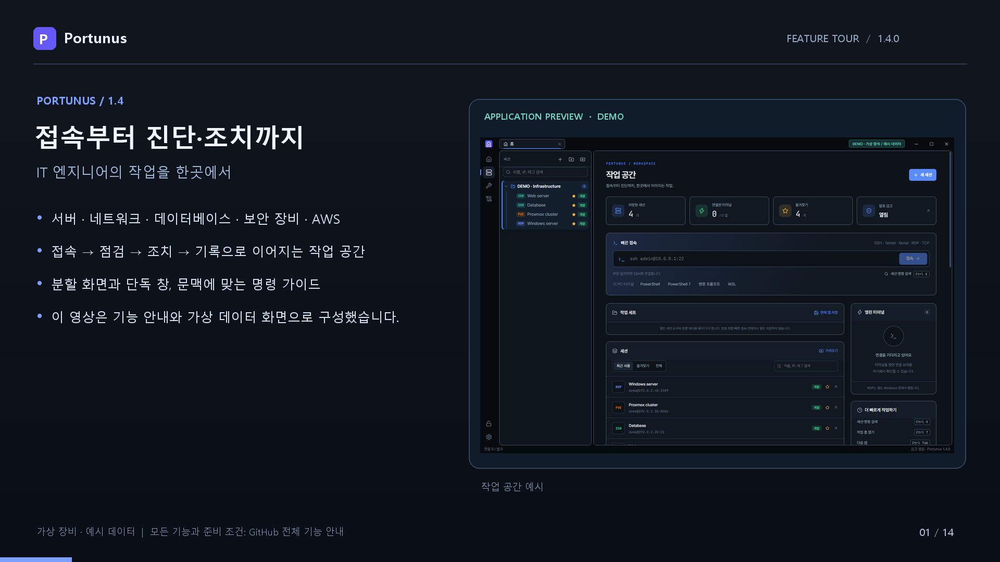

# Portunus

**한국어** · [English](README.en.md)

> **English:** Portunus is a Windows remote access and operations workspace for IT engineers — SSH, SFTP, RDP, VNC, Proxmox, IPMI, SNMP, Docker, Kubernetes, databases, HTTP, AWS and network diagnostics in one app. The app is available in English (Settings → Display → Language). [Read the English introduction →](README.en.md)

**접속하고, 진단하고, 조치하는 IT 엔지니어의 작업 공간.**

Portunus는 Windows에서 서버·네트워크·DB·보안 장비·클라우드를 운영하는 엔지니어를 위한 원격 접속·운영 도구입니다.

**[최신 설치 파일 다운로드](https://github.com/bluewind201/Portunus/releases/latest)**

SSH·SFTP·Telnet·시리얼·RDP·VNC·RustDesk, Proxmox·IPMI·SNMP, Docker·Kubernetes, DB·HTTP·AWS 관리와 네트워크 진단을 한곳에서 사용합니다.

## Portunus의 강점

| 강점 | 실제 작업에서 달라지는 점 |
|---|---|
| **접속에서 조치까지 이어지는 흐름** | IP 검색 결과를 자산으로 등록하고, 저장한 SSH 연결로 터미널·SFTP·Docker·Kubernetes 작업을 이어갑니다. AWS RDS 접속 정보도 DB 탐색기로 넘깁니다. |
| **엔지니어의 입력을 돕는 터미널** | Linux·Cisco·DB 문맥에 맞는 하위 명령·옵션·인수 추천, 다음 단계 안내, vim 단축키 안내를 제공합니다. 위험 명령은 실행 전 확인하도록 설정할 수 있습니다. |
| **여러 장비를 함께 보는 화면** | 2~4분할, 탭을 끌어 별도 창으로 분리·합치기, 여러 터미널 동시 입력, 작업 세트 저장으로 반복 작업을 줄입니다. |
| **물리 서버부터 클라우드까지** | IPMI 하드웨어 상태·전원, Proxmox VM 콘솔, Docker·k8s/k3s, DB, AWS EC2·RDS·S3를 각 관리 화면에서 다룹니다. |
| **별도 전용 에이전트 없이 하는 점검** | IP 검색·DNS·TCP·HTTPS 일괄 점검은 대상에 Portunus 에이전트를 설치하지 않습니다. 서버 관리는 기존 SSH·API·SNMP·BMC 인터페이스를 활용합니다. |
| **접속 정보 보관과 이관** | Argon2id 기반 마스터 암호와 AES-256-GCM 금고, CSV·Excel 가져오기, 암호 없는 CSV 또는 암호화 세션 백업을 제공합니다. |

**[전체 기능 안내 →](docs/FEATURES.md)** · [기능 소개 영상 →](https://github.com/bluewind201/Portunus/releases/download/v1.4.0/portunus-features-v1.4.mp4)

## 어떤 작업을 할 수 있나요?

| 분야 | 주요 기능 |
|---|---|
| 원격 접속·파일 | SSH·Telnet·시리얼·Raw TCP, SFTP, 외부 RDP·RustDesk, 내장 VNC, 점프 호스트·SSH 터널 |
| 터미널 생산성 | 문맥별 자동 완성·다음 단계·명령 스니펫·위험 명령 확인·vim/less/top/nano 안내·로그 |
| 작업 공간 | 세션 폴더·검색·즐겨찾기·환경 표시, 2~4분할·단독 창·동시 입력·작업 세트 |
| 네트워크 진단 | IP 대역 검색·경로 분석·핑·경로 추적·포트 스캔·DNS·SNMP·장비 통합 점검·패킷 분석 |
| 서버·가상화 | Docker·Kubernetes/k3s/microk8s·Proxmox VE·IPMI/BMC |
| DB·API | PostgreSQL·MySQL/MariaDB·SQLite, SQL 조회·변경·운영 점검, HTTP 요청·URL 일괄 확인 |
| AWS | IAM 키·기존 CLI 프로필·SSO, EC2·RDS·S3·VPC·보안 그룹·IAM 점검·SSM 접속 |
| 운영 지원 | 설정 비교·Nmap·VPN 연결 상태·내장 SFTP/TFTP/Syslog 서버 |
| 계산·변환 | 서브넷·MAC·Wake-on-LAN, JSON·Base64·URL·JWT·Unix 시간·SHA-256 |
| 보관·개인화 | 암호 금고·저장 암호 일괄 변경·가져오기/내보내기·14개 테마·선택형 PC 정보·서명 검증 업데이트·한국어/영어 화면 |

## 전체 기능 소개 영상

**[분야별 기능과 강점을 살펴보기 (MP4, 1분 38초)](https://github.com/bluewind201/Portunus/releases/download/v1.4.0/portunus-features-v1.4.mp4)**

원격 접속, 터미널 입력 보조, 네트워크 진단, 서버·DB·AWS, 보관·설정까지 기능별 소개 카드와 예시 화면으로 안내합니다. 아래 24초 영상은 주요 화면의 조작을 짧게 보여주는 데모입니다.

## 24초로 살펴보기

**[소개 영상 보기·다운로드 (MP4, 약 24초)](https://github.com/bluewind201/Portunus/releases/download/v1.4.0/portunus-intro-v1.4.mp4)**

작업 공간 → IP 대역 검색 → 설정 비교 → 테마 설정 순서로 살펴봅니다. 영상은 소리 없이 한국어 자막으로 안내합니다.

> 실제 앱 UI에 가상 장비·예시 데이터를 넣어 촬영했습니다. PC 이름·실제 계정·사설/공인 IP·게이트웨이·저장된 접속 정보는 포함하지 않았습니다. `192.0.2.x`는 문서용 예시 주소이며, IP 검색 결과는 데모 데이터입니다.

## 화면으로 살펴보기

### 접속과 운영을 한곳에 모은 작업 공간

세션과 즐겨찾기를 정리하고, 빠른 접속과 엔지니어 도구로 작업을 이어갑니다.

### 필요한 IP 대역만 검색

CIDR 또는 시작·끝 주소로 범위를 지정하고, 응답과 열린 포트를 확인한 뒤 자산으로 등록하거나 CSV로 저장합니다.

### 설정 변경을 줄 단위로 비교

장비·서비스 설정의 추가·삭제를 색으로 구분하고 변경된 줄만 확인합니다.

### 나에게 맞는 작업 환경

14개 테마, 강조색, 화면 간격과 글꼴을 선택하고 터미널·금고·업데이트 설정을 항목별로 관리합니다.

## 설치 및 업데이트

- Windows 11 x64. 설치 파일은 사용자 계정에 설치되며 WebView2 설치본을 포함합니다.
- 화면 언어는 처음 실행할 때 Windows 표시 언어를 따르며, 설정 → 화면 → 언어 · Language에서 한국어·English로 바꿀 수 있습니다.
- 설치 후 설정 → 업데이트에서 새 버전을 확인합니다. 1.4부터 시작 시와 6시간마다 자동 확인하며 설치 전에 연결 종료·재시작을 확인합니다.
- 1.3 이하 사용자는 1.4 이상을 한 번 직접 설치해야 합니다.
- 업데이트 파일은 앱에 내장된 공개 키로 서명을 검증합니다. 설치 전에 사용자 DB를 백업하고 기존 세션·암호 금고·설정을 유지합니다.
- `SHA256SUMS.txt`로 설치 파일 해시를 비교할 수 있습니다. `.sig`와 `latest.json`은 앱 업데이트용입니다.
- Windows 코드 서명 인증서의 신뢰와 SmartScreen 평판은 업데이트 서명과 별개입니다. 배포 파일의 게시자·해시와 다운로드 출처를 확인하세요.

## 1.5 변경

- 영어 화면: 설정 → 화면 → 언어 · Language에서 한국어·English를 고릅니다. 메뉴·안내·확인 창·알림·오류와 터미널 명령 추천·명령 가이드까지 바뀝니다(IP 대역 검색 화면은 한국어 유지).
- 영어 소개 문서(README.en.md)를 추가했습니다.

## 1.4 변경

- IP 대역 검색: CIDR 또는 시작/끝 IPv4, ICMP·TCP 응답, 결과 필터·CSV·자산 등록. 한 번에 최대 65,536개 주소.
- Proxmox·SNMP·IPMI CSV/Excel 가져오기 및 기본 포트 보완. Proxmox는 계정 암호와 API 토큰을 구분합니다.
- 작은 창에서도 우클릭 메뉴가 위로 열리고 모든 항목을 사용할 수 있습니다.
- 서명된 릴리스 기반 자동 업데이트와 설치 전 DB 백업.

이 저장소는 **배포 전용**입니다. 애플리케이션 소스 코드는 포함하지 않습니다. GitHub가 자동 제공하는 Source code ZIP/TAR에는 이 저장소의 안내 파일과 소개 이미지가 들어갑니다. 설치하려면 Releases의 설치 파일을 받으세요.

함께 배포하는 외부 도구의 라이선스·원저작권·소스 안내는 설치 폴더의 `tools/THIRD-PARTY-NOTICES.txt`와 라이선스 폴더에 포함되어 있습니다. Portunus 자체의 소스 사용 권한을 부여하는 저장소가 아닙니다.
