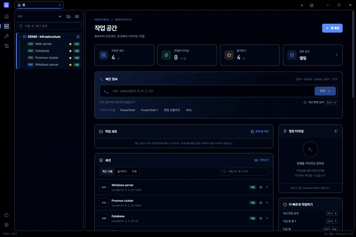
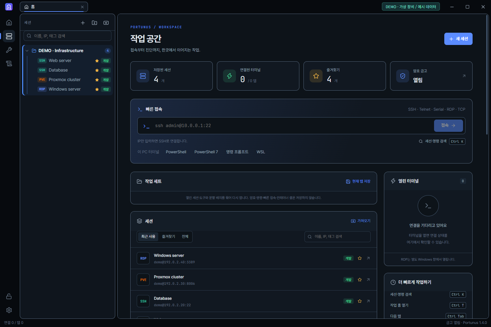
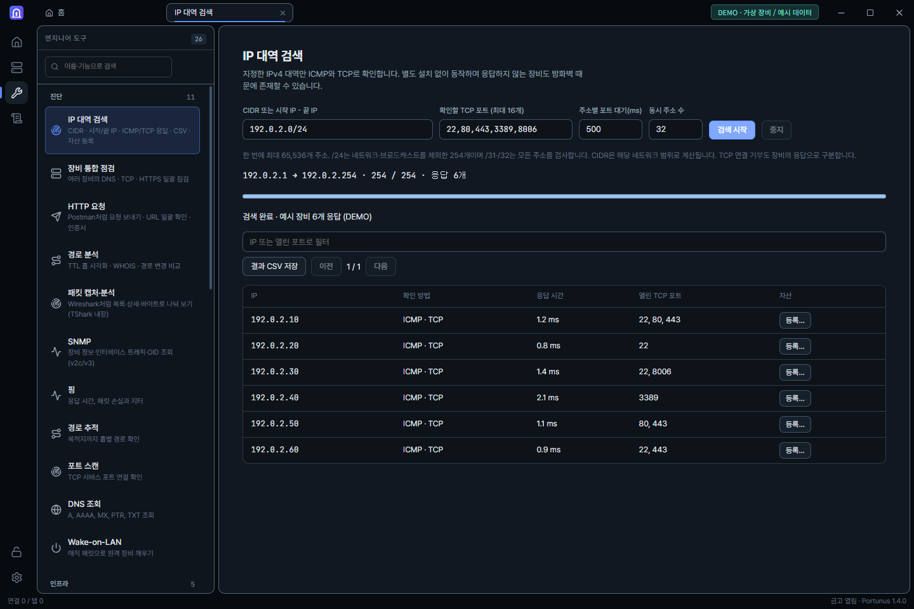
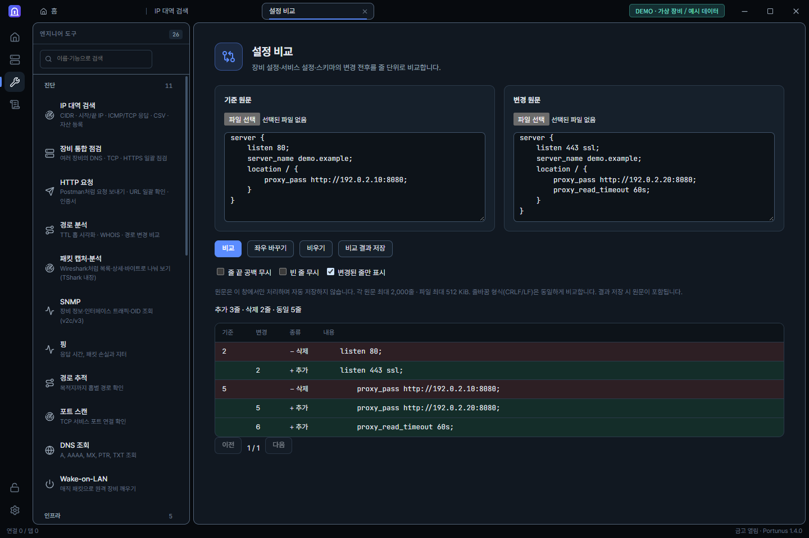
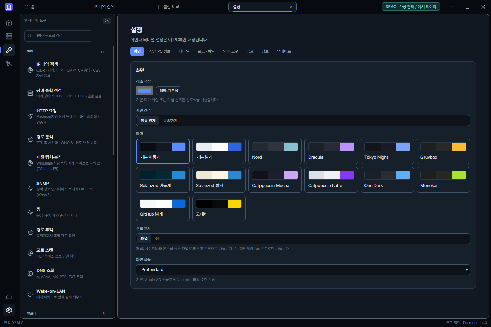

# Portunus

Windows IT 엔지니어를 위한 원격 접속·운영 도구입니다.

**[최신 설치 파일 다운로드](https://github.com/bluewind201/Portunus/releases/latest)**

SSH·SFTP·Telnet·시리얼·RDP·VNC·RustDesk, Proxmox·IPMI·SNMP, Docker·Kubernetes, DB·HTTP·AWS 관리와 네트워크 진단을 한곳에서 사용합니다.

## 24초로 살펴보기

**[소개 영상 보기·다운로드 (MP4, 약 24초)](https://github.com/bluewind201/Portunus/releases/download/v1.4.0/portunus-intro-v1.4.mp4)**

작업 공간 → IP 대역 검색 → 설정 비교 → 테마 설정 순서로 살펴봅니다. 영상은 소리 없이 한국어 자막으로 안내합니다.

> 실제 앱 UI에 가상 장비·예시 데이터를 넣어 촬영했습니다. PC 이름·실제 계정·사설/공인 IP·게이트웨이·저장된 접속 정보는 포함하지 않았습니다. `192.0.2.x`는 문서용 예시 주소이며, IP 검색 결과는 데모 데이터입니다.

## 화면으로 살펴보기

### 접속과 운영을 한곳에 모은 작업 공간

세션과 즐겨찾기를 정리하고, 빠른 접속과 엔지니어 도구로 작업을 이어갑니다.

### 필요한 IP 대역만 검색

CIDR 또는 시작·끝 주소로 범위를 지정하고, 응답과 열린 포트를 확인한 뒤 자산으로 등록하거나 CSV로 저장합니다.

### 설정 변경을 줄 단위로 비교

장비·서비스 설정의 추가·삭제를 색으로 구분하고 변경된 줄만 확인합니다.

### 나에게 맞는 작업 환경

14개 테마, 강조색, 화면 간격과 글꼴을 선택하고 터미널·금고·업데이트 설정을 항목별로 관리합니다.

## 설치 및 업데이트

- Windows 11 x64. 설치 파일은 사용자 계정에 설치되며 WebView2 설치본을 포함합니다.
- 설치 후 설정 → 업데이트에서 새 버전을 확인합니다. 1.4부터 시작 시와 6시간마다 자동 확인하며 설치 전에 연결 종료·재시작을 확인합니다.
- 1.3 이하 사용자는 1.4 이상을 한 번 직접 설치해야 합니다.
- 업데이트 파일은 앱에 내장된 공개 키로 서명을 검증합니다. 설치 전에 사용자 DB를 백업하고 기존 세션·암호 금고·설정을 유지합니다.
- `SHA256SUMS.txt`로 설치 파일 해시를 비교할 수 있습니다. `.sig`와 `latest.json`은 앱 업데이트용입니다.
- Windows 코드 서명 인증서의 신뢰와 SmartScreen 평판은 업데이트 서명과 별개입니다. 배포 파일의 게시자·해시와 다운로드 출처를 확인하세요.

## 1.4 변경

- IP 대역 검색: CIDR 또는 시작/끝 IPv4, ICMP·TCP 응답, 결과 필터·CSV·자산 등록. 한 번에 최대 65,536개 주소.
- Proxmox·SNMP·IPMI CSV/Excel 가져오기 및 기본 포트 보완. Proxmox는 계정 암호와 API 토큰을 구분합니다.
- 작은 창에서도 우클릭 메뉴가 위로 열리고 모든 항목을 사용할 수 있습니다.
- 서명된 릴리스 기반 자동 업데이트와 설치 전 DB 백업.

이 저장소는 **배포 전용**입니다. 애플리케이션 소스 코드는 포함하지 않습니다. GitHub가 자동 제공하는 Source code ZIP/TAR에는 이 저장소의 안내 파일과 소개 이미지가 들어갑니다. 설치하려면 Releases의 설치 파일을 받으세요.

함께 배포하는 외부 도구의 라이선스·원저작권·소스 안내는 설치 폴더의 `tools/THIRD-PARTY-NOTICES.txt`와 라이선스 폴더에 포함되어 있습니다. Portunus 자체의 소스 사용 권한을 부여하는 저장소가 아닙니다.
